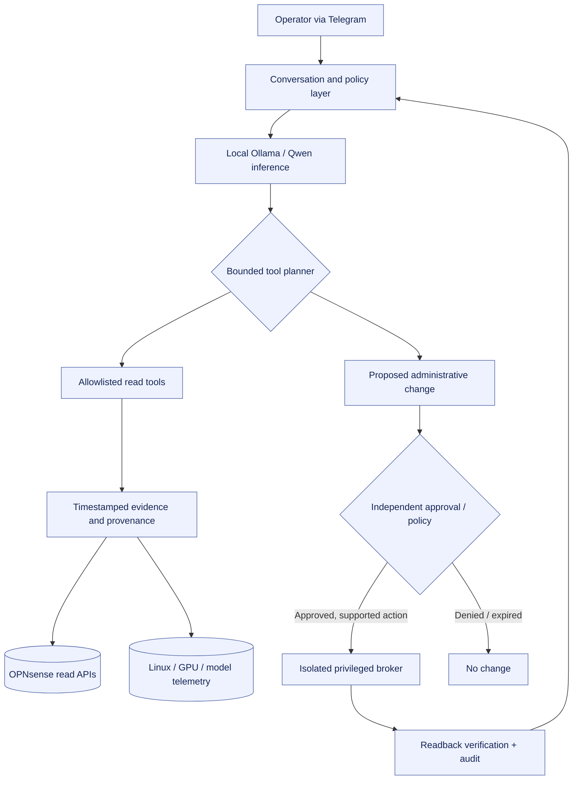

<div align="center">

# JT Cyber & AI Lab
### Evidence-Grounded AI Security Operations & Network Automation

**Local LLMs · Python · OPNsense · Linux · Zero-Trust Design · Human-Approved Change Control**

[Architecture](docs/ARCHITECTURE.md) · [Engineering case study](docs/PROJECT_CASE_STUDY.md) · [Run the safe demo](docs/DEMO.md) · [Security policy](docs/SECURITY.md) · [Roadmap](docs/ROADMAP.md)

</div>

> **Public portfolio edition.** This repository intentionally contains **synthetic telemetry, fictional IP ranges, sample policies, and offline-first demonstration code**. It contains **no production OPNsense configuration, administrative credentials, Telegram bot token, real host inventory, SSH keys, firewall rules, or live network access**.

## Project overview

I designed and iteratively built a **self-hosted security-operations assistant** that combines a local Qwen-class language model with authenticated infrastructure monitoring and controlled network administration. The private lab integrates an OPNsense firewall, Linux collectors, several Ollama services distributed across NVIDIA GPUs, historical observations, and a Telegram conversational interface.

The engineering challenge was to make an assistant useful for **actual security operations**, rather than merely generating plausible-sounding reports. The design emphasizes provenance, typed tool calls, safe privilege separation, operator approvals, and post-action verification.

**This repository is a representative, sanitized implementation and engineering case study—not a dump or clone of the live deployment.**

## Why this project matters

| Engineering area | Demonstrated capability |
|---|---|
| **AI engineering** | Ollama `/api/chat` native function calling, bounded tool-use loop, local inference integration |
| **Security operations** | Source-aware evidence reconciliation, explicit uncertainty, avoidance of fabricated CVEs/incidents |
| **Network engineering** | OPNsense interface, gateway, ARP, DHCP, traffic and firewall-statistics collection patterns |
| **Secure automation** | Separate privileged broker architecture, time-limited approval design and audit trail |
| **Infrastructure / DevOps** | Linux `systemd`, Python services, scheduled telemetry, testing and CI |
| **PKI / API security** | Internal CA issuance, verified TLS, restricted API credential handling |
| **Reliability** | Backups, syntax checks, incremental integration, operational verification and rollback planning |

## Architecture at a glance



The **public runnable code** implements only the synthetic read-tool pathway and an **in-memory approval simulation**. Real privileged write endpoints and administrator secrets are never shipped in this repository.

## What was verified in the private project

The following are historical engineering milestones, not claims of current operational status:

- **Authenticated OPNsense read APIs:** Six data sources returned HTTP 200 in project tests: interface overview, ARP, interface traffic, aggregate firewall statistics, gateway status and Dnsmasq leases.
- **Collector reliability:** The OPNsense observer completed successfully under systemd, and three Linux SSH collectors returned healthy snapshots in the recorded validation.
- **TLS remediation:** Replaced an expired web-interface certificate with an internal-CA-issued certificate; a non-`-k` HTTPS request using the CA returned HTTP 200.
- **Native LLM tool calls:** A local Qwen 9B-class model emitted a structured `get_opnsense_gateway_status` call through Ollama `/api/chat`.
- **Telegram integration:** A conversation interface, timestamped observer bridge, source-aware response router, and advanced SOC prompting were installed and the service reported active.
- **Broker design:** A separated administrator service passed a connectivity probe; Telegram staged a host-alias creation with a time-limited approval code and successfully acknowledged cancellation.

**Not yet established by the evidence:** a completed administrator **write and post-write verification**, comprehensive firewall/NAT/DHCP/VLAN editing, verified production-grade identity enforcement for broker actions, or fully reliable AI-led investigations. Details: [Implementation status](docs/IMPLEMENTATION_STATUS.md).

## Run the safe demo (Python 3.10+)

No firewall, Telegram token, API key, GPU, or model download is required.

```bash
# macOS/Linux (from the repository root)
PYTHONPATH=src python -m cyberlab_demo inventory
PYTHONPATH=src python -m cyberlab_demo summary
PYTHONPATH=src python -m cyberlab_demo investigate
PYTHONPATH=src python -m cyberlab_demo approval-demo

# Run the offline automated test suite and repository safety scan
PYTHONPATH=src python -m unittest discover -s tests -v
python scripts/check_public_safety.py
```

On Windows PowerShell, set `$env:PYTHONPATH="src"` and run the same `python -m ...` commands.

**Optional local tool-calling demo:** with Ollama already running on loopback and a model installed:

```bash
PYTHONPATH=src python -m cyberlab_demo investigate --ollama \
  --model YOUR_LOCAL_MODEL \
  --question "Check gateway status and explain what the fixture cannot prove."
```

The optional model sees **synthetic fixture data only**, and the code rejects non-loopback Ollama endpoints. See [DEMO.md](docs/DEMO.md) for details and expected outcomes.

## Representative sample configuration

- [`configs/network-plan.example.json`](configs/network-plan.example.json) — fictional VLANs, gateways and segmentation intent
- [`configs/agent-policy.example.json`](configs/agent-policy.example.json) — read-tool allowlist and illustrative write-approval controls
- [`configs/systemd/observer-demo.service`](configs/systemd/observer-demo.service) — non-production systemd hardening sketch
- [`fixtures/synthetic_snapshot.json`](fixtures/synthetic_snapshot.json) — fake ARP, DHCP, gateways, traffic, Linux and GPU data
- [`src/cyberlab_demo/`](src/cyberlab_demo/) — readable, testable Python prototype

## Responsible disclosure and reproducibility

Everything under `fixtures/` and `configs/` is fabricated for demonstration. The internal 18-page project report, screenshots, operational IP addresses, production configs, credentials and raw logs **are intentionally not included**. The [security documentation](docs/SECURITY.md) describes the publication controls and threat model. CI runs both behavioral tests and a repository exposure scan.

## Future development

The private project roadmap prioritizes reproducible model-assisted investigations, additional scoped read tools, strong broker-side operator identity, safely constrained rule changes, pre/post-state verification, and high-risk rollback controls. See [Roadmap](docs/ROADMAP.md).

## About the author

**JT Corbin** — cybersecurity and IT professional, BBA in Management Information Systems; graduate studies in Applied AI. Interests: network security, self-hosted AI, security automation, Linux infrastructure, and reliable AI tool use.

*This is a personal engineering portfolio project and is not affiliated with or endorsed by OPNsense, Ollama, Telegram, or any model provider.*

**License:** MIT for the demonstration code and documentation. Production private configurations and unpublished systems are not included.
