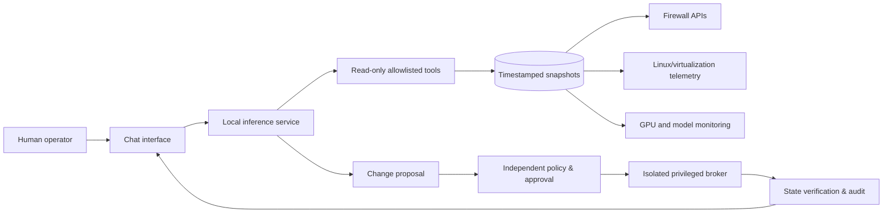

# Reference Architecture (Sanitized)

## Logical components

The arrows represent architectural intent. **The public runnable code ships only fake data, read tools and an in-memory approval simulator.**

## Synthetic network plan

| Zone | Example CIDR | Function | Isolation intent |
|---|---|---|---|
| Trusted | `10.250.10.0/24` | operator workstations | management-only ingress to services |
| Servers | `10.250.30.0/24` | applications / core services | allowlist required paths |
| IoT | `10.250.70.0/24` | lower-trust devices | deny lateral access by default |
| WAN | `198.51.100.0/24` (documentation) | fictional external segment | explicitly filtered |

These addresses are entirely fictitious. Do not infer any production address, VLAN ID or real forwarding path from these examples.

## Trust boundaries

**Zone A — Conversation/model:** prompts, conversations and tool suggestions are untrusted inputs for privileged state changes. Model output cannot itself grant authority.

**Zone B — Read-only collectors:** only authorized read endpoints, source timestamps, fixed schema and bounded results. Hostnames/log text are data, not control instructions.

**Zone C — Privileged broker:** separate process identity, minimum allowed operations, explicit human authorization and verified target state. The public demo never reaches Zone C with real credentials.

## Why separate ARP, DHCP and liveness

- ARP: neighbor observations, subject to aging and intermediary/network behavior.
- DHCP: address assignments/leases, not necessarily proof of a currently reachable host.
- Ping/SSH/service probe: evidence of a response to one protocol from one vantage point, not complete availability.
- Firewall counters: traffic summaries; not forensic conclusions or CVE findings.

The demonstration returns `reachability: NOT_TESTED` rather than inventing a host status.

## Latency and resilience

For a production-grade system, snapshot generation and AI generation should be decoupled. A degraded inference endpoint should not interrupt scheduled infrastructure monitoring. Cached values must expose timestamps and freshness limits; an operator should be able to inspect evidence without waiting for model inference.

## Changes and recovery

An actual network mutation needs an idempotency key, current-state precheck, explicit proposed diff, approval identity, action-specific permission, timeout, readback verification, audit and rollback. Automatic rollback is difficult when a rule could lock out management; out-of-band recovery is part of the design.
